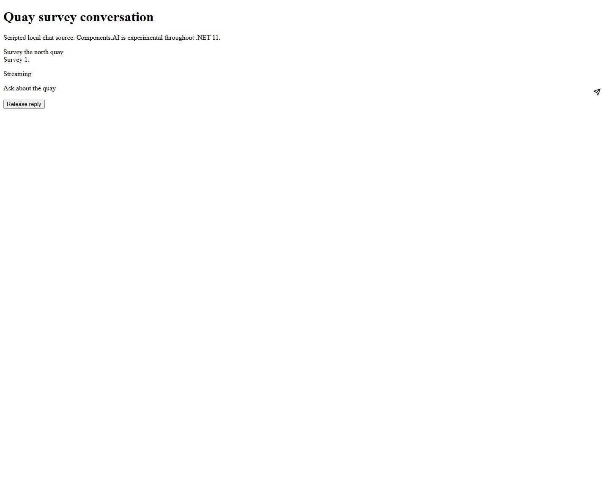

# Streamed conversation history and browser form protection

[PIN-804](https://linear.app/pinguapps/issue/PIN-804) delivers
`blazor.stream-agent-conversation/11.0`.
[PIN-808](https://linear.app/pinguapps/issue/PIN-808) delivers
`web.protect-browser-form-posts/11.0`.
Both include original complete .NET 10/11 sources and offline prose. Existing
goal/edition identities and the eight curated .NET 10 foundations are retained.

## Actual artifacts and behavior

The four consumers are under `samples/net10.0` and `samples/net11.0`, in
`QuayChat` and `QuayPermits`. Each has its own build/package boundaries and
locked restore. SDKs are **10.0.402** and **11.0.100-rc.2.26504.105**;
language modes are **14.0** and **15.0**; actual framework/runtime versions are
**10.0.13** and **11.0.0-rc.2.26504.105**. No workload or account is needed.
Compilation records retain their actual source commit and dirty marker, input
hashes, resolved assets, exact commands and output. They are compilation records,
separate from browser and HTTP execution.

QuayChat uses AI.Abstractions **10.6.0**, selecting its **net10.0** asset on both
targets. The new renderer is the actual Components.AI
**0.1.0-preview.1.26466.103** package, built from
`dotnet/dotnet@b2f96bd7ac75c07fb8067c05c54767d3d5e12e8d`.
It has only a net11.0 compile asset. The SDK prunes its framework-provided
Components.Web dependency. No net10.0 Components.AI route is claimed.
**Components.AI remains experimental throughout .NET 11**, in discovery and detail.

[Chat observations](PIN-804-808/chat.browser.json) record actual Chrome 155
extension interactions with both Interactive Server consumers, with prerendering
disabled. Each first fragment remains held until Release reply. The real new
RichContentBlock retains its ID while changing Active to Inactive; the second
stream keeps the first exchange visible and receives three input messages.
The older manual IChatClient loop does the same useful task. The deliberate
script-like text remains ordinary Razor text with no script descendant.
The stream source is explicitly scripted; this is real renderer/stream evidence,
not model, remote provider, AG-UI or model-quality evidence.



[Seventy real HTTP checks](PIN-804-808/http.evidence.json), produced by
`eng/Test-QuaySamples.ps1`, cover:

- SSR, form-bound Minimal API, MVC and Razor Pages: same-origin acceptance,
  cross-origin rejection, valid token pairs and missing-token rejection.
- Additional-data acceptance/rejection, token emission, headerless automatic
  requests, Fetch Metadata precedence and unchanged JSON behavior.
- Explicit credentialed CORS trust on /trusted; other origins remain rejected.
- A valid token can override an automatic origin verdict in this RC2 pipeline.
  This control uses a deliberately supplied valid pair; it does not claim an
  attacker can obtain that pair.

[Browser form observations](PIN-804-808/forms.browser.json) separately record
actual form clicks, same-origin requests, cross-site submissions from localhost
to 127.0.0.1, credentialed CORS trust, and missing/custom-data token failures.
Temporary form action/token changes were made through the supported browser
developer interface, then reset by navigation. No server protection was bypassed.
The browser's origin-scoped network capture drops cross-origin headers.
For empty MVC/Page 400 responses, Chrome displays ERR_BLOCKED_BY_CLIENT;
[matching Kestrel status lines](PIN-804-808/browser-kestrel.txt) establish the
server's 400 response. The Minimal API response names CsrfValidationException.

The recorded DLL hashes still match the final matching-SDK builds. The final
.NET 10 chat browser check was refreshed after whitespace normalization.
Other rebuilt DLLs stayed byte-identical to their browser-tested versions.

## Reconciled source and applicability

[Pinned official source review](PIN-804-808/sources.evidence.json) is distinct
from compilation and execution. It establishes two material boundaries:

1. The downloadable experimental package supplies the streaming renderer used
   here. Later tool, approval, typed state and durable restore goals remain
   separate work; no unavailable API is invented for this delivery.
2. Current migration prose overstates the checked RC2 MVC/Page integration.
   MVC must use **RequireAntiforgeryToken** for the middleware route.
   ValidateAntiForgeryToken still runs a token filter; combining the attributes
   is rejected. Razor Pages still installs its automatic token filter, so the
   Page retains its token even in the otherwise automatic sample.

Keep token services, middleware, issuance and validation for older browsers,
additional token data or compliance requirements. RC2 can overwrite the automatic
verdict with the token verdict; coexistence alone does not establish two
independent enforced layers. Explicit credentialed CORS origins are write trust.
Wildcard/public-read CORS does not grant that trust in the pinned implementation.
JSON endpoints are unchanged. Authentication, authorization, production cookies,
proxy configuration and application storage are outside these local demonstrations.

## Installed offline boundary

The existing packed-tool Reqnroll scenario is extended with both goals; there is
no new OS/client/native matrix. It installs the exact package from an isolated
local feed/cache, initializes real stdio outside the checkout with blocked proxy
settings, and compares the entire independently expanded Markdown. It checks
discovery ID/title/goal, experimental stability, complete nested applicability,
all saved evidence fields, edition 11.0 and target-10 refusal. The .NET 10 sources
are comparisons, not new catalogue foundations.

The returned bodies also reconstruct all four consumers through
`eng/Test-QuayConsumer.ps1`, copying no canonical checkout files. Each complete
project compiles with its matching SDK. This is separate compilation of installed
guidance, not a claim that the reconstructed hosts repeated the canonical browser
checks. The Page's first @page directive comes from its explicit served instruction.

The first attempts found missing embedded test inputs and omitted empty route
dimensions in the expected metadata. Those were fixed. A broad Inspector query
also matched an existing quay-related recipe; the handoff now uses two exact
sample tags. Failed attempts are not counted as passing verification.

Validation includes all four matching-SDK builds with zero warnings/errors,
the 70 HTTP checks, actual Chrome checks, Release solution build, the extended
installed scenario, host smoke, content/evidence rejection guards, and dependency
policy/Renovate checks. Renovate resolved **529** dependencies and protected
**486** sample entries. Root dependencies and automatic update permissions are
unchanged; all new sample pins remain author-maintained.

## Inspect what an agent receives

Requires PowerShell 7, the pinned .NET SDKs and Node 24. Inspector setup uses pinned
**2.11.0**, with npm lifecycle scripts disabled. The following block is tested
starting from unrelated `C:\Windows`:

```powershell
Set-Location -LiteralPath 'V:\_worktrees\Playbook\t3-aacbceff'
$env:DOTNET_ADD_GLOBAL_TOOLS_TO_PATH = '0'
$ErrorActionPreference = 'Stop'
$PSNativeCommandUseErrorActionPreference = $true
& 'C:\Users\pingu\AppData\Local\dotnetup\dotnet\dotnet.exe' build ./PinguApps.Playbook.slnx -c Release -p:Version=0.0.0-pin804-808
& 'C:\Users\pingu\AppData\Local\dotnetup\dotnet\dotnet.exe' pack ./src/PinguApps.Playbook -c Release --no-build -p:PackageVersion=0.0.0-pin804-808 --output ./artifacts
& ./eng/Inspect-QuayGuidance.ps1 -PackageVersion 0.0.0-pin804-808
```

Expect exactly two read-only MCP tools and these two discovery descriptions:
`blazor.stream-agent-conversation` (experimental streamed replies/history) and
`web.protect-browser-form-posts` (automatic protection plus retained token cases).
The wrapper prints ID, title, **goal**, stability, both complete old/new Markdown
bodies and full applicability/evidence, through real installed stdio list/get.
Each resolves edition 11.0. Missing prose, unresolved snippets, lost experimental
labels, another edition or absent constraints fails the check.
Responses and the package SHA-256 receipt are saved under
`artifacts/pin804-808/inspection`. Installed retrieval needs no content network.

To compile only the files received in those installed responses:

```powershell
Set-Location -LiteralPath 'V:\_worktrees\Playbook\t3-aacbceff'
& ./eng/Test-QuayConsumer.ps1 -Dotnet 'C:\Users\pingu\AppData\Local\dotnetup\dotnet\dotnet.exe'
```

## Exercise the samples

```powershell
Set-Location -LiteralPath 'V:\_worktrees\Playbook\t3-aacbceff'
$env:DOTNET_ADD_GLOBAL_TOOLS_TO_PATH = '0'
$ErrorActionPreference = 'Stop'
$PSNativeCommandUseErrorActionPreference = $true
foreach ($major in @(10, 11)) {
    foreach ($app in @('QuayChat', 'QuayPermits')) {
        Push-Location "./samples/net$major.0/$app"
        try {
            & 'C:\Users\pingu\AppData\Local\dotnetup\dotnet\dotnet.exe' build "$app.csproj" -c Release -p:RestoreLockedMode=true
        } finally { Pop-Location }
    }
}
& ./eng/Test-QuaySamples.ps1 -Dotnet 'C:\Users\pingu\AppData\Local\dotnetup\dotnet\dotnet.exe' -KeepRunning
```

The helper returns after 70 HTTP assertions. It leaves only its recorded hosts
running when KeepRunning is supplied. Visit ports **6010/6011** for the old/new
chat; send First survey, observe a held partial response, release it, then send
Second survey. The earlier exchange must remain visible, and the final response
must report Input messages=3.

Ports **6012/6013/6014/6015** are the old token, new automatic, new retained-token
and deliberately rejected additional-data form hosts. Submit their linked forms.
The ordinary hosts show accepted: lanterns; 6015 rejects. New automatic forms
omit tokens except for the deliberately retained Razor Page. Port **6019** hosts
the separate local sender used by the browser CORS/cross-site checks. The source
form's action must target 127.0.0.1:6013 to reproduce a cross-site submission;
/trusted alone grants its localhost origin credentialed trust.
These samples store no application data. Missing partial output/history, an
unexpected 200/400, lost tokens or a disconnected circuit is a failure.

After closing the pages, stop only matching recorded hosts:

```powershell
Set-Location -LiteralPath 'V:\_worktrees\Playbook\t3-aacbceff'
Get-Content ./artifacts/quay/processes.json -Raw | ConvertFrom-Json | ForEach-Object {
    $process = Get-CimInstance Win32_Process -Filter "ProcessId=$($_.pid)"
    if ($process -and $process.CommandLine.Contains($_.dll)) {
        Stop-Process -Id $_.pid
    }
}
```

## Coverage, provenance and limits

Every target criterion maps to its original sample pair, metadata/Markdown,
actual compilation, claim-specific execution, existing installed-tool harness
and source-disposition update. Applicability explicitly includes runtime, SDK,
language, exact package/assets, provider, platform, rendering and stability.
No required API, compilation route or Human proof is left missing.

Sources consulted: both tickets, SPEC.md at
`0a8989814ea11346354464b845c79c15bb71c5e9`, approved proposal `b3778cc`,
WEB-032/041/083, GLOSSARY, ADRs 0001–0004, the Blazor audit, dependency policy and
PIN-668's delivered installed stdio seam. Root PLAN.md, CONTEXT.md and
CONTEXT-MAP.md are absent. No explicit target provenance pointer is unresolved.
The connector's optional get_agent_context endpoint returned tool-not-found;
repository evidence was used directly.

PIN-668 was the only related issue read that changed an implementation decision:
reuse the existing installed package seam. No related Linear issue changed.
Both target estimates remain **L (5)**: independent old/new authoring, real
multi-turn/multi-form behavior and packaged offline verification justify that scale.

No live model, AG-UI, durable conversation storage, broad browser/platform matrix,
production authentication/cookie deployment, GA, trimming or AOT proof is claimed.
Those are explicit applicability limits, not outstanding required Human proof.
No package/account/resource was published or provisioned. Process/user/machine
PATH checks passed. Sources, locks and bounded receipts remain reviewable;
the pragent-ignore assessment adds no exclusion.
